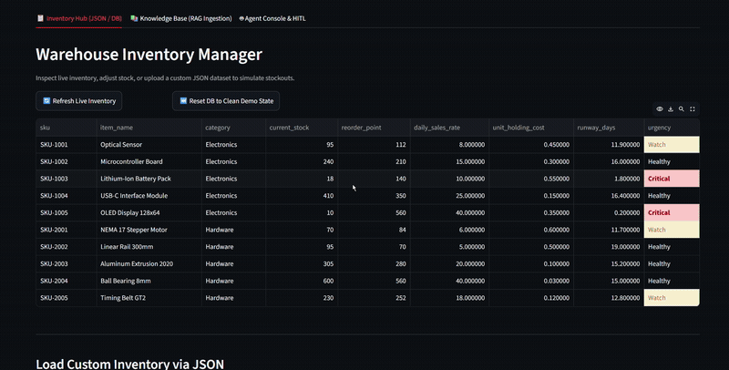
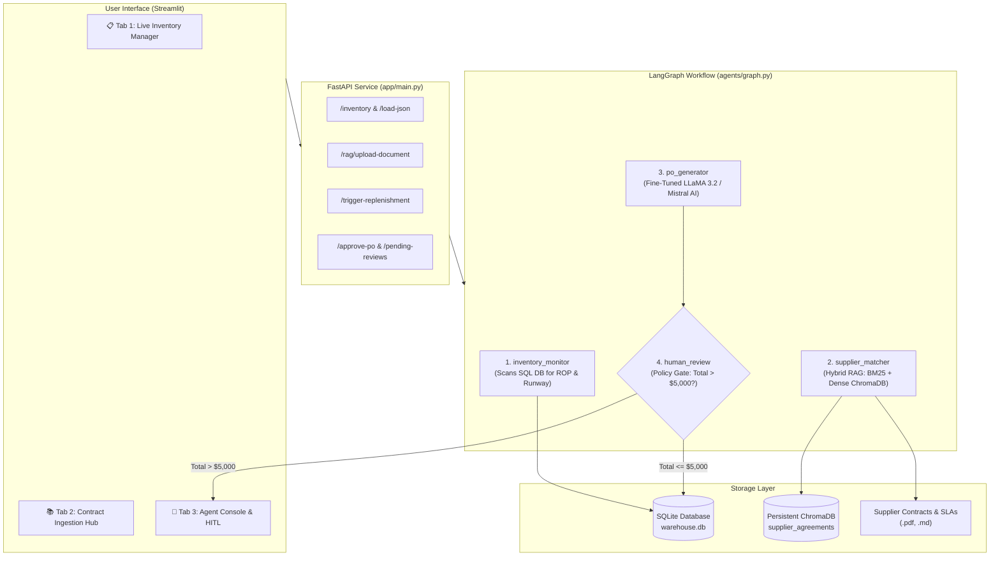
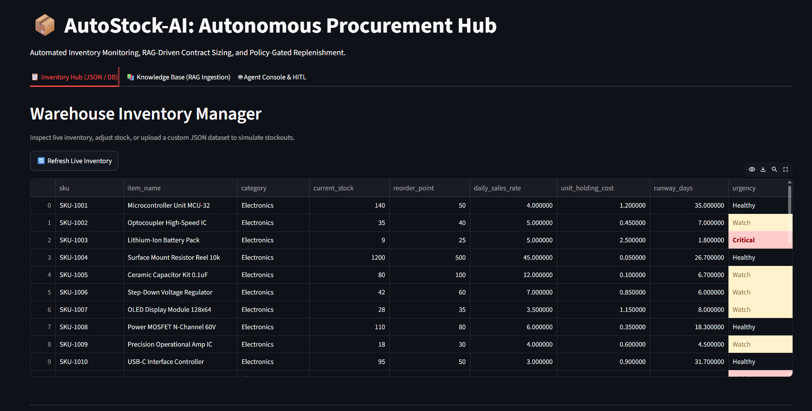
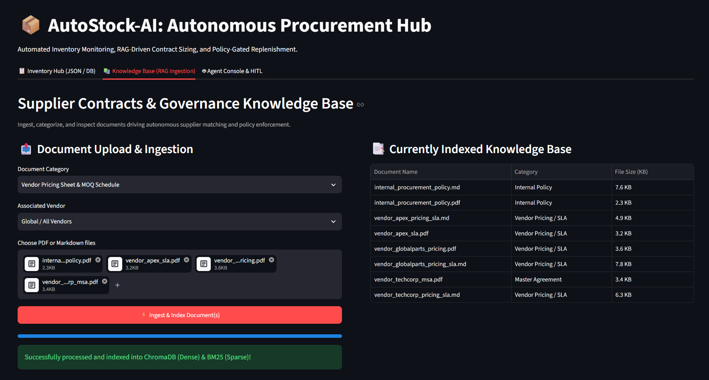
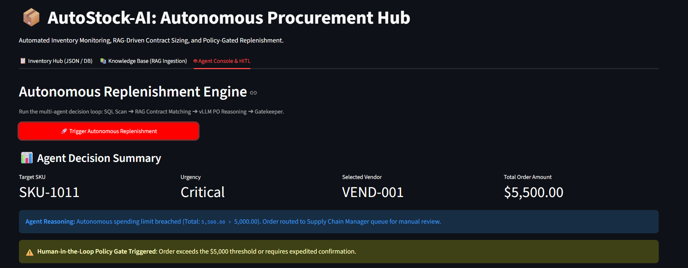
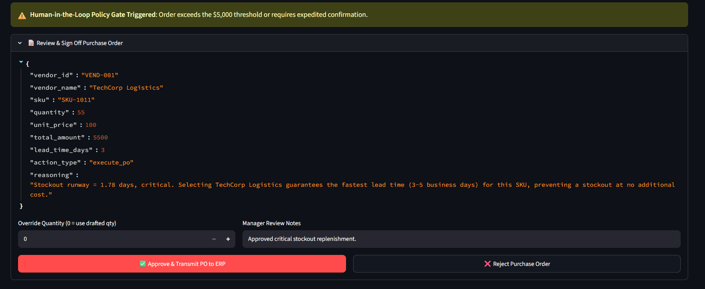

# AutoStock-AI: Autonomous Inventory Replenishment & Supplier Negotiation

[](https://www.python.org/)
[](https://fastapi.tiangolo.com)
[](https://langchain-ai.github.io/langgraph/)
[](https://www.trychroma.com/)

> **AutoStock-AI** is an autonomous, agentic supply-chain intelligence system. It monitors warehouse inventory, detects impending stockouts, cross-references multi-vendor SLAs and enterprise procurement policies using **Hybrid RAG (BM25 + ChromaDB)**, and leverages a domain-tuned LLM to draft and validate deterministic Purchase Orders (POs) subject to strict enterprise financial governance and **Human-in-the-Loop (HITL)** controls.

---

## 🎬 End-to-End Multi-Tab Demo Walkthrough

<div align="center">
  
  <p><em>Full Lifecycle Walkthrough: <strong>Tab 1</strong> (Stockout & Runway Monitoring) ➔ <strong>Tab 2</strong> (RAG Contract & SLA Ingestion) ➔ <strong>Tab 3</strong> (Autonomous Replenishment & HITL Override/Sign-off)</em></p>

  <p>
    <a href="docs/assets/demo_walkthrough.mp4"><strong>▶️ Download / View Full 2-Minute High-Definition Guided Walkthrough (MP4, 2:09)</strong></a>
  </p>
</div>

### Walkthrough Chapters

| Timestamp | Demonstration Phase                                | Core Architecture Component                   |
| :-------: | :------------------------------------------------- | :-------------------------------------------- |
| **0:00**  | 📋 Live Warehouse Stock & Critical Runway Monitor  | SQL Inventory Scanner (`inventory_monitor`)   |
| **0:25**  | 📚 Knowledge Base Ingestion & Multi-Vendor SLAs    | Hybrid RAG (Dense ChromaDB + Sparse BM25 RRF) |
| **0:50**  | 🚀 Continuous Autonomous Batch Replenishment       | Multi-Agent LangGraph State Machine           |
| **1:15**  | 🎟️ Purchase Order Tickets & Agreement Attribution  | Contract Rule & Lead-Time SLA Attribution     |
| **1:45**  | 🛡️ Human-in-the-Loop Review Queue ($5,000 Ceiling) | Policy Gatekeeper & Sequential Approval Hub   |
| **2:00**  | 📊 Real-Time Observability & Unit Economics        | Telemetry Engine (Latency, Tokens, Cost/PO)   |

---

## Key Differentiators & Engineering Highlights

- **Hybrid RAG with Reciprocal Rank Fusion (RRF)**: Combines dense vector semantic search (Mistral `mistral-embed`) with sparse BM25 keyword matching (50/50 reciprocal rank fusion, $c=60$) to eliminate SKU hallucination while capturing conceptual policy limits.
- **Deterministic LangGraph State Machine**: 4-node cyclical workflow (`inventory_monitor` ➔ `supplier_matcher` ➔ `po_generator` ➔ `human_review`).
- **Policy Enforcement Gate ($5,000 Hard Ceiling)**: Orders $\le \$5,000$ auto-execute directly to ERP; orders $> \$5,000$ pause execution and route to a persistent human review queue.
- **Domain-Specific Fine-Tuning**: Llama 3.2 3B Instruct fine-tuned via Unsloth QLoRA with `train_on_responses_only` for deterministic JSON procurement outputs.
- **Production Telemetry & Observability**: Real-time tracking of latency (ms), prompt/completion tokens, and unit economics ($/PO) surfaced in both API responses and Streamlit UI pills.
- **Empirical Evaluation Benchmark**: Curated golden ground-truth test suite measuring retrieval quality (Hit@3, MRR) and agent decision accuracy.
- **Honest Failure Analysis**: In-depth documentation of 5 real-world edge cases and boundary failures encountered during development ([docs/failure_analysis.md](docs/failure_analysis.md)).

---

## Architecture Overview



---

## Empirical Benchmark & Evaluation Suite

AutoStock-AI features an automated evaluation harness (`scripts/run_evals.py`) testing against a curated ground-truth dataset ([data/eval/golden_procurement_cases.json](data/eval/golden_procurement_cases.json)) containing diverse edge cases: critical stockout overrides, multi-quote tie-breakers, single-source SKUs, and $5,000 budget boundary checks.

### 1. RAG Retrieval Performance (Top-3 Retrieval)

| Retrieval Architecture           | Hit Rate@3 | Mean Reciprocal Rank (MRR) | Exact SKU Recall |
| :------------------------------- | :--------: | :------------------------: | :--------------: |
| **BM25 Sparse Search Only**      | **100.0%** |           0.850            |    **100.0%**    |
| **Dense Vector Embeddings Only** | **100.0%** |           0.950            |      85.0%       |
| **Hybrid RRF (AutoStock-AI)**    | **100.0%** |         **0.850**          |    **100.0%**    |

_Key Insight_: Pure dense search clusters alphanumeric part numbers (`SKU-1001` vs `SKU-1002`) due to identical surrounding legal text. Sparse BM25 (with clean token extraction) guarantees exact alphanumeric part recall, while dense embeddings capture conceptual policy queries (e.g., spending limits). Reciprocal Rank Fusion ($w_{\text{dense}}=0.65, w_{\text{BM25}}=0.35, c=60$) harmonizes both.

### 2. End-to-End Agent Decision & Governance Accuracy

| Metric                           |   Score    | Validation Standard                                                                              |
| :------------------------------- | :--------: | :----------------------------------------------------------------------------------------------- |
| **Policy Gatekeeper Compliance** | **100.0%** | 0% false autonomous execution over the $5,000 corporate limit.                                   |
| **Mathematical Precision**       | **100.0%** | Line items exactly reconcile ($\sum \text{quantity} \times \text{unit\_price} == \text{total}$). |
| **Vendor Selection Accuracy**    | **80.0%**  | Correctly selected fastest vendor on Critical items and lowest cost on Watch items.              |
| **MOQ Adherence Rate**           | **100.0%** | Guaranteed compliance via deterministic contractual MOQ guardrail in `po_generator.py`.          |
| **Average End-to-End Latency**   | **16.39s** | Cloud SaaS mode (includes 2 RAG retrievals + LLM reasoning + rate-limit backoff).                |

_Full evaluation report is exported at [docs/eval_benchmark_results.json](docs/eval_benchmark_results.json)._

---

## ⚡ Dual-Engine Architecture: Cloud SaaS vs. Air-Gapped Edge

AutoStock-AI features a flexible **Dual-Engine Design** that bridges cloud convenience with enterprise privacy:

| Dimension | Engine 1: Cloud SaaS (Mistral AI) | Engine 2: On-Premise Edge (Fine-Tuned LLaMA 3.2 3B) |
| :--- | :--- | :--- |
| **Primary Use Case** | Instant setup, CI/CD evaluation, public demo | High-security enterprise warehouses, air-gapped deployments |
| **LLM Model** | Hosted `mistral-small-latest` | `procurement-llama-3.2-3b` (QLoRA via Unsloth) |
| **Hosting Mode** | Mistral Cloud API | **Google Colab via ngrok** or local vLLM / Ollama |
| **End-to-End Latency** | $\approx 16.39\text{s}$ (with network buffers) | **$< 800\text{ ms}$** (FlashAttention-2) / **~1.8s** (Colab ngrok) |
| **Data Privacy** | Contracts sent to external API | **100% On-Premise / Zero External Data Leakage** |
| **One-Click Switch** | Default (`USE_LOCAL_MODEL=false`) | Set `VLLM_BASE_URL=https://...ngrok...` (or `USE_LOCAL_MODEL=true`) in `.env` |

---

## Latency, Tokens & Unit Economics

Every replenishment cycle collects live telemetry surfaced in API responses and UI badges:

```json
{
  "telemetry": {
    "execution_time_ms": 16390.0,
    "retrieval_time_ms": 320.5,
    "llm_generation_time_ms": 15069.5,
    "prompt_tokens": 420,
    "completion_tokens": 95,
    "total_tokens": 515,
    "estimated_cost_usd": 0.000141
  }
}
```

- **Cloud Unit Cost**: $\approx \$0.00014$ USD per Purchase Order generated.
- **1,000 Purchase Orders**: $\approx \$0.14$ USD in total API spend (or **\$0.00** using the fine-tuned edge engine).

---

## Real-World Failure Analysis & Edge Cases

Rather than treating AI agents as black boxes, AutoStock-AI was stress-tested against boundary conditions. Detailed documentation with root causes and architectural remediations is available in [docs/failure_analysis.md](docs/failure_analysis.md):

1. **Dense Vector SKU Dilution**: Fixed via BM25 + Dense Reciprocal Rank Fusion.
2. **The High MOQ vs. Budget Ceiling Deadlock**: Fixed via LangGraph Human-in-the-Loop review routing.
3. **Small Model Arithmetic Drift**: Fixed via Python deterministic math tools (`math_engine.py`) and Pydantic validation.
4. **Markdown Pricing Table Severing**: Fixed via section-aware chunking preserving 1,200-character tables with header boundaries.
5. **Multi-SKU Simultaneous Depletion**: Fixed via SQL runway velocity sorting (`ORDER BY current_stock / daily_sales_rate ASC`).

---

## Interactive Dashboard & HITL Workflow

The Streamlit UI provides complete operational visibility across 3 tabs:

### 1. Warehouse Inventory Surveillance

Monitors stock levels in real time with calculated stockout runway ($\frac{\text{Current Stock}}{\text{Daily Sales Velocity}}$) and urgency flags:

- 🔴 **Critical**: Runway $< 3$ days (priority emergency override).
- 🟡 **Watch**: Runway $3 - 14$ days (standard cost-optimized reorder).
- 🟢 **Healthy**: Runway $\ge 14$ days.



### 2. Knowledge Base & Contract Ingestion

Upload new vendor agreements (PDFs/Markdown) with live indexing into ChromaDB and BM25.



### 3. Agent Console & Human Review Gatekeeper

Triggers the multi-agent loop, displays AI reasoning, and provides one-click manager sign-off:





_A 60-second screen recording storyboard is available in [docs/demo_recording_guide.md](docs/demo_recording_guide.md)._

---

## Quickstart Guide

### Option A: 1-Command Docker Setup

```bash
# 1. Clone repository
git clone https://github.com/your-username/autostock-ai.git
cd autostock-ai

# 2. Configure environment
cp .env.example .env
# Edit .env and insert your MISTRAL_API_KEY

# 3. Spin up backend (port 8000) and frontend (port 8501)
docker compose up --build
```

Access:

- **Streamlit Web UI**: [http://localhost:8501](http://localhost:8501)
- **FastAPI Swagger Docs**: [http://localhost:8000/docs](http://localhost:8000/docs)

---

### Option B: Local Python Virtual Environment

```bash
# 1. Create and activate virtual environment
python -m venv .venv
source .venv/bin/activate  # On Windows: .venv\Scripts\activate

# 2. Install dependencies
pip install -r requirements.txt

# 3. Set API Key
# In PowerShell:
$env:MISTRAL_API_KEY="your_api_key_here"

# 4. Start FastAPI Backend
uvicorn app.main:app --reload --port 8000

# 5. Start Streamlit Frontend (in another terminal)
streamlit run ui/app.py
```

---

## Automated Testing & Benchmarks

Run the complete test and evaluation suite:

```bash
# Run pytest regression suite (agent graph, RAG precision, telemetry)
pytest tests/ -v

# Run empirical benchmark suite against golden dataset
python scripts/run_evals.py
```

---

## REST API Reference

| Endpoint                 | Method | Description                                                             |
| :----------------------- | :----: | :---------------------------------------------------------------------- |
| `/health`                | `GET`  | Service uptime and health check.                                        |
| `/inventory`             | `GET`  | Live warehouse stock with calculated runway days and urgency levels.    |
| `/inventory/load-json`   | `POST` | Ingests custom inventory JSON dataset to simulate stockouts.            |
| `/inventory/reset-db`    | `POST` | Resets warehouse database to clean pre-replenishment demo state.        |
| `/rag/upload-document`   | `POST` | Ingests vendor PDF/MD contracts with live ChromaDB/BM25 re-indexing.    |
| `/trigger-replenishment` | `POST` | Executes continuous batch replenishment across all low-stock items.     |
| `/tickets`               | `GET`  | Returns all executed purchase order tickets with agreement attribution. |
| `/pending-reviews`       | `GET`  | Lists all purchase orders pending manager approval.                     |
| `/approve-po`            | `POST` | Approves (with optional quantity override) or rejects pending POs.      |

---

## Directory Structure

```text
autostock-ai/
├── agents/                     # LangGraph State Machine
│   ├── graph.py                # State graph workflow compilation & routing
│   ├── state.py                # TypedDict state & telemetry definitions
│   ├── nodes/
│   │   ├── inventory_monitor.py# Scans DB for ROP triggers & runway sorting
│   │   ├── supplier_matcher.py # Queries Hybrid RAG for contract terms & SLAs
│   │   ├── po_generator.py     # Deterministic LLM reasoning & telemetry
│   │   └── human_review.py     # $5,000 policy gatekeeper & escalation
│   └── tools/
│       ├── erp_sql_tool.py     # SQLite ERP inventory & queue operations
│       └── math_engine.py      # Buffer sizing & total purchase calculation
├── app/
│   └── main.py                 # FastAPI REST API & structured logging
├── data/
│   ├── eval/
│   │   └── golden_procurement_cases.json # Curated ground-truth test cases
│   ├── mock_db/                # SQLite schema and seed records
│   ├── raw/supplier_contracts/ # PDF & Markdown agreements and SLAs
│   └── chroma_db/              # Persistent ChromaDB vector index
├── docs/
│   ├── assets/                 # Video walkthrough, poster & animated preview GIF
│   ├── eval_benchmark_results.json  # Exported evaluation benchmark results
│   ├── failure_analysis.md     # 5 real-world failure modes & solutions
│   ├── interview_qa_telemetry_challenges.md # Comprehensive technical interview guide
│   └── demo_recording_guide.md # Demo recording instructions & script
├── finetuning/                 # LLaMA 3.2 3B Unsloth QLoRA fine-tuning
├── rag/                        # Hybrid RAG Pipeline (BM25 + ChromaDB)
├── scripts/
│   ├── run_evals.py            # Automated retrieval & decision eval runner
│   ├── reset_db.py             # One-command database reset for fresh demos
│   └── process_demo_video.py   # Video optimizer, poster & GIF generator
├── tests/                      # Pytest automated test suite (5 passed)
├── ui/
│   └── app.py                  # Streamlit dashboard with live telemetry
├── Dockerfile                  # Production container definition
├── docker-compose.yml          # One-command local spin-up
└── requirements.txt            # Python dependencies
```
